# Zustandsautomaten in SoloOffice

**Stand:** 2026-11-09

Dieses Dokument listet alle Stellen, an denen SoloOffice einen Zustand mit
festen Werten und Übergängen führt. Der Abschnitt „Fachstatus“ wird aus
`backend/shared/stateMachines.js` erzeugt und darf nicht von Hand geändert
werden. Alles darunter ist ein gepflegtes Inventar mit offenen Punkten.

## So arbeitet man damit

- **Status lesen oder anzeigen:** `statusLabel`, `statusBadgeClass` und
  `statusDotClass` aus `src/utils/statusDisplay.ts`. Keine eigenen
  `switch`-Blöcke oder Beschriftungstabellen in Komponenten anlegen.
- **Statusauswahl anbieten:** `manualTargets` (ein Datensatz) oder
  `manualTargetsForSelection` (Mehrfachauswahl) aus dem Register.
- **Statuswechsel prüfen (Server und Demo):** `checkManualTransition` liefert
  `null` oder eine deutsche Fehlermeldung mit Code.
- **Regel ändern oder Status ergänzen:** nur in
  `backend/shared/stateMachines.js` (und `.d.ts`, wenn ein Automat neu ist).
  Danach `node scripts/state-machine-docs.mjs` ausführen. Neue Statuswerte
  brauchen zusätzlich eine Migration für die CHECK-Bedingung und den
  TypeScript-Typ; die Vertragstests melden jede Abweichung.
- **Tests:** `backend/test/stateMachines.test.js` (Register gegen
  Migrationen) und `test/frontend/stateMachines.test.mjs` (Register gegen
  TypeScript-Typen, Farbzuordnung und dieses Dokument).

Auslöser in den Tabellen: **von Hand** = der Nutzer wählt den Status direkt,
**Aktion** = nur über eine eigene Funktion erreichbar, **automatisch** = das
System leitet den Status ab.

## Fachstatus

<!-- BEGIN GENERIERT: node scripts/state-machine-docs.mjs -->

### Rechnung (`invoice`)

- Art: Ablauf mit Übergängen
- Speicherort: `invoices.status` · Typ `InvoiceStatus`
- Startzustand: Entwurf (`draft`)

| Wert | Anzeige | Farbton | Endzustand |
|---|---|---|---|
| `draft` | Entwurf | neutral | – |
| `sent` | Versendet | primary | – |
| `overdue` | Überfällig | danger | – |
| `reminded_1x` | 1x gemahnt | warning | – |
| `reminded_2x` | 2x gemahnt | warningStrong | – |
| `reminded_3x` | 3x gemahnt | dangerStrong | – |
| `paid` | Bezahlt | success | – |

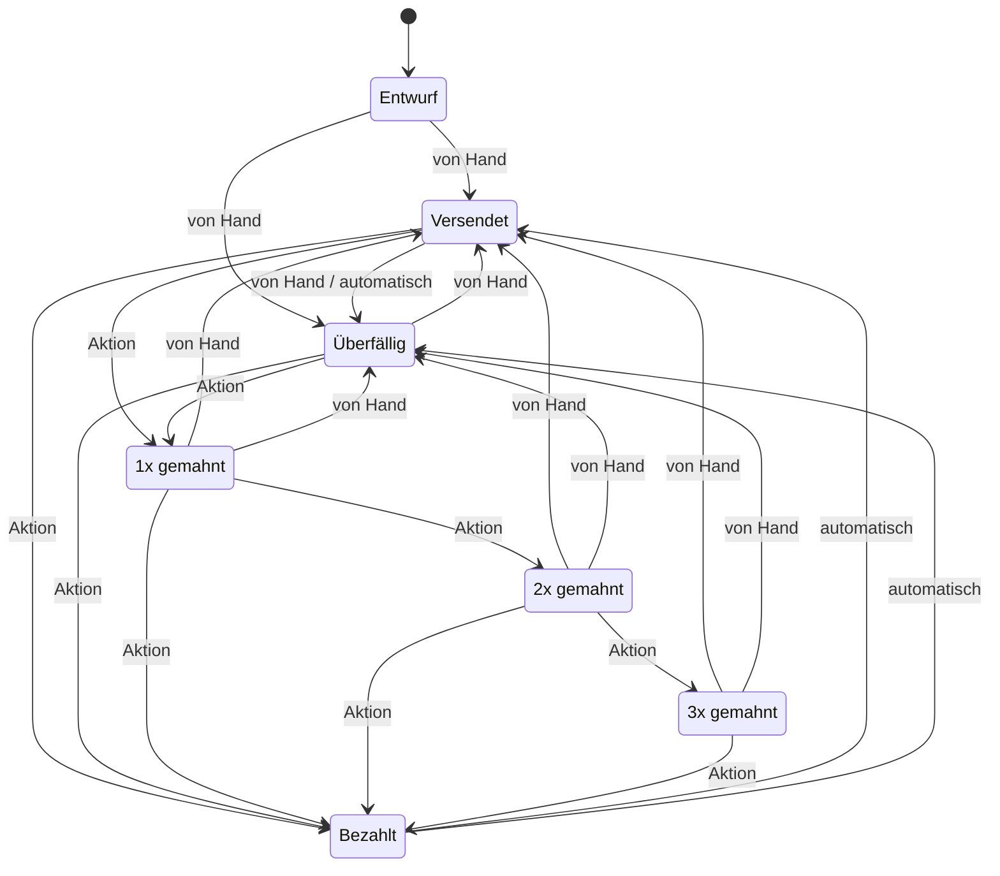

| Von | Nach | Auslöser | Wodurch | Bedingung |
|---|---|---|---|---|
| `draft` | `sent` | von Hand | Ausstellen oder versenden | Mindestens eine Position |
| `draft` | `overdue` | von Hand | Als überfällig ausstellen | Mindestens eine Position |
| `sent` | `overdue` | von Hand | Als überfällig markieren | – |
| `sent` | `overdue` | automatisch | Fälligkeitsdatum überschritten (beim Öffnen der Rechnungsliste) | – |
| `overdue` | `sent` | von Hand | Auf versendet zurücksetzen | – |
| `reminded_1x` | `sent` | von Hand | Auf versendet zurücksetzen | – |
| `reminded_2x` | `sent` | von Hand | Auf versendet zurücksetzen | – |
| `reminded_3x` | `sent` | von Hand | Auf versendet zurücksetzen | – |
| `reminded_1x` | `overdue` | von Hand | Auf überfällig zurücksetzen | – |
| `reminded_2x` | `overdue` | von Hand | Auf überfällig zurücksetzen | – |
| `reminded_3x` | `overdue` | von Hand | Auf überfällig zurücksetzen | – |
| `sent` | `reminded_1x` | Aktion | 1. Mahnung senden | Offener Betrag |
| `overdue` | `reminded_1x` | Aktion | 1. Mahnung senden | Offener Betrag |
| `reminded_1x` | `reminded_2x` | Aktion | 2. Mahnung senden | Offener Betrag |
| `reminded_2x` | `reminded_3x` | Aktion | 3. Mahnung senden | Offener Betrag |
| `sent` | `paid` | Aktion | Zahlungseingang erfassen | Zahlungen decken den Rechnungsbetrag |
| `overdue` | `paid` | Aktion | Zahlungseingang erfassen | Zahlungen decken den Rechnungsbetrag |
| `reminded_1x` | `paid` | Aktion | Zahlungseingang erfassen | Zahlungen decken den Rechnungsbetrag |
| `reminded_2x` | `paid` | Aktion | Zahlungseingang erfassen | Zahlungen decken den Rechnungsbetrag |
| `reminded_3x` | `paid` | Aktion | Zahlungseingang erfassen | Zahlungen decken den Rechnungsbetrag |
| `paid` | `sent` | automatisch | Zahlung storniert, Fälligkeit noch nicht erreicht | – |
| `paid` | `overdue` | automatisch | Zahlung storniert, Fälligkeit überschritten | – |

- Ausgestellte Rechnungen kehren nie zum Entwurf zurück; Korrekturen laufen über eine Gutschrift.
- „Bezahlt“ wird ausschließlich aus den erfassten Zahlungen abgeleitet und lässt sich nicht von Hand setzen.
- Das allgemeine Update nimmt Mahnstufen derzeit auch direkt an (durch Tests abgesichert); die Oberfläche bietet das nicht an.

### Gutschrift (`creditNote`)

- Art: Ablauf mit Übergängen
- Speicherort: keine eigene Statusspalte
- Startzustand: Entwurf (`draft`)

| Wert | Anzeige | Farbton | Endzustand |
|---|---|---|---|
| `draft` | Entwurf | neutral | – |
| `sent` | Versendet | primary | ja |
| `paid` | Altstatus prüfen | warning | ja |

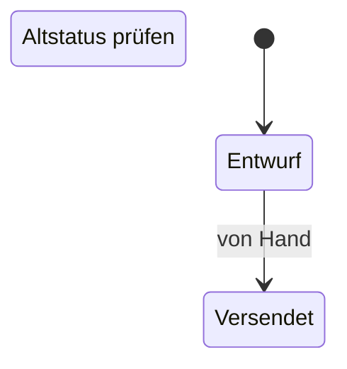

| Von | Nach | Auslöser | Wodurch | Bedingung |
|---|---|---|---|---|
| `draft` | `sent` | von Hand | Als versendet markieren | – |

- Gutschriften liegen in der Tabelle `invoices` (document_type = credit_note) und kennen nur Entwurf und versendet.
- „paid“ stammt aus alten Datenständen; Rückzahlung und Verrechnung gibt es noch nicht.

### Angebot (`quote`)

- Art: Ablauf mit Übergängen
- Speicherort: `quotes.status` · Typ `QuoteStatus`
- Startzustand: Entwurf (`draft`)

| Wert | Anzeige | Farbton | Endzustand |
|---|---|---|---|
| `draft` | Entwurf | neutral | – |
| `sent` | Versendet | primary | – |
| `accepted` | Akzeptiert | success | – |
| `rejected` | Abgelehnt | danger | – |
| `expired` | Abgelaufen | warning | – |
| `billed` | Abgerechnet | settled | ja |

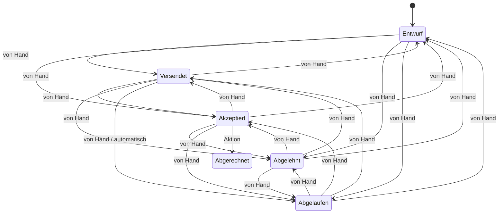

| Von | Nach | Auslöser | Wodurch | Bedingung |
|---|---|---|---|---|
| `draft` | `sent` | von Hand | Status wählen | – |
| `draft` | `accepted` | von Hand | Status wählen | – |
| `draft` | `rejected` | von Hand | Status wählen | – |
| `draft` | `expired` | von Hand | Status wählen | – |
| `sent` | `draft` | von Hand | Status wählen | – |
| `sent` | `accepted` | von Hand | Status wählen | – |
| `sent` | `rejected` | von Hand | Status wählen | – |
| `sent` | `expired` | von Hand | Status wählen | – |
| `accepted` | `draft` | von Hand | Status wählen | – |
| `accepted` | `sent` | von Hand | Status wählen | – |
| `accepted` | `rejected` | von Hand | Status wählen | – |
| `accepted` | `expired` | von Hand | Status wählen | – |
| `rejected` | `draft` | von Hand | Status wählen | – |
| `rejected` | `sent` | von Hand | Status wählen | – |
| `rejected` | `accepted` | von Hand | Status wählen | – |
| `rejected` | `expired` | von Hand | Status wählen | – |
| `expired` | `draft` | von Hand | Status wählen | – |
| `expired` | `sent` | von Hand | Status wählen | – |
| `expired` | `accepted` | von Hand | Status wählen | – |
| `expired` | `rejected` | von Hand | Status wählen | – |
| `sent` | `expired` | automatisch | Gültigkeit überschritten (beim Öffnen der Angebotsliste) | – |
| `accepted` | `billed` | Aktion | In Rechnung umwandeln | – |

- „Abgerechnet“ entsteht nur durch die Umwandlung in eine Rechnung und ist endgültig.
- Löschen ist nur für unabhängige Entwürfe möglich.

### Auftrag (`job`)

- Art: Ablauf mit Übergängen
- Speicherort: `job_entries.status` · Typ `JobStatus`
- Startzustand: Entwurf (`draft`)

| Wert | Anzeige | Farbton | Endzustand |
|---|---|---|---|
| `draft` | Entwurf | neutral | – |
| `in-progress` | In Bearbeitung | progress | – |
| `completed` | Abgeschlossen | success | – |
| `invoiced` | Abgerechnet | settled | – |

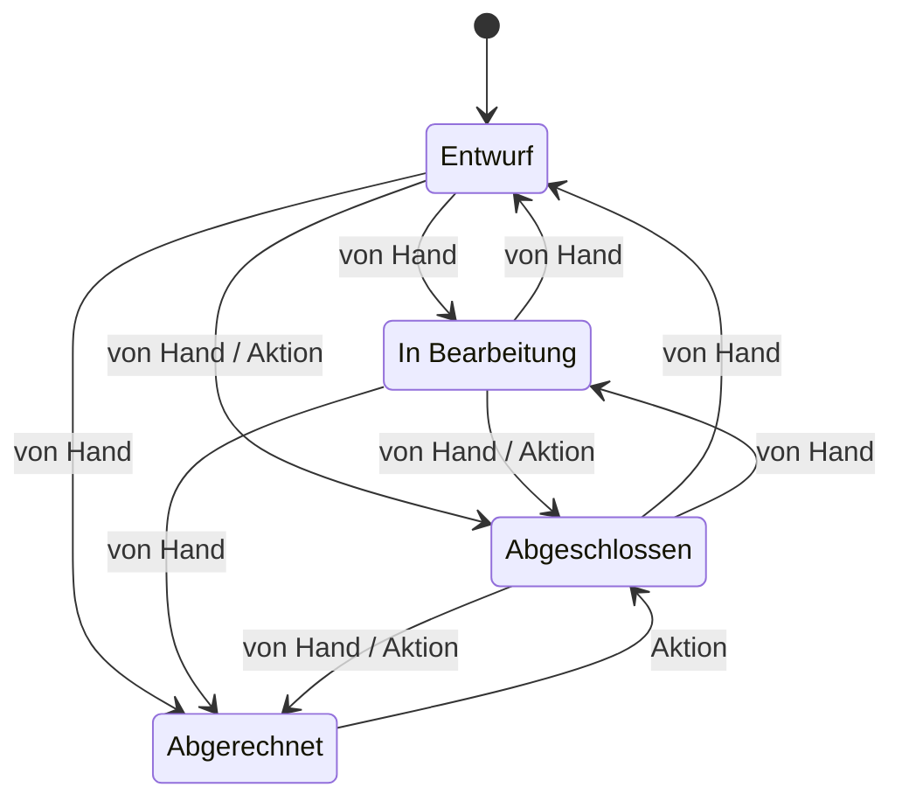

| Von | Nach | Auslöser | Wodurch | Bedingung |
|---|---|---|---|---|
| `draft` | `in-progress` | von Hand | Status wählen | Kunde, Titel und Beschreibung außerhalb des Entwurfs |
| `draft` | `completed` | von Hand | Status wählen | Kunde, Titel und Beschreibung außerhalb des Entwurfs |
| `in-progress` | `draft` | von Hand | Status wählen | Kunde, Titel und Beschreibung außerhalb des Entwurfs |
| `in-progress` | `completed` | von Hand | Status wählen | Kunde, Titel und Beschreibung außerhalb des Entwurfs |
| `completed` | `draft` | von Hand | Status wählen | Kunde, Titel und Beschreibung außerhalb des Entwurfs |
| `completed` | `in-progress` | von Hand | Status wählen | Kunde, Titel und Beschreibung außerhalb des Entwurfs |
| `draft` | `invoiced` | von Hand | Von Hand als abgerechnet markieren | Kunde, Titel und Beschreibung |
| `in-progress` | `invoiced` | von Hand | Von Hand als abgerechnet markieren | Kunde, Titel und Beschreibung |
| `completed` | `invoiced` | von Hand | Von Hand als abgerechnet markieren | Kunde, Titel und Beschreibung |
| `completed` | `invoiced` | Aktion | Rechnung aus Aufträgen erstellen | – |
| `draft` | `completed` | Aktion | Unterschrift erfassen | – |
| `in-progress` | `completed` | Aktion | Unterschrift erfassen | – |
| `invoiced` | `completed` | Aktion | Zugehörigen Rechnungsentwurf löschen | – |

- Abgerechnete Aufträge sind gesperrt: kein Bearbeiten, kein Statuswechsel.
- Ein von Hand gesetztes „Abgerechnet“ ohne Rechnung lässt sich nicht zurücknehmen (offene Produktentscheidung).

### Wiederkehrende Rechnung (`recurringInvoice`)

- Art: Ablauf mit Übergängen
- Speicherort: `recurring_invoices.status` · Typ `RecurringInvoiceStatus`
- Startzustand: Aktiv (`active`)

| Wert | Anzeige | Farbton | Endzustand |
|---|---|---|---|
| `active` | Aktiv | success | – |
| `paused` | Pausiert | warning | – |
| `ended` | Beendet | neutral | ja |

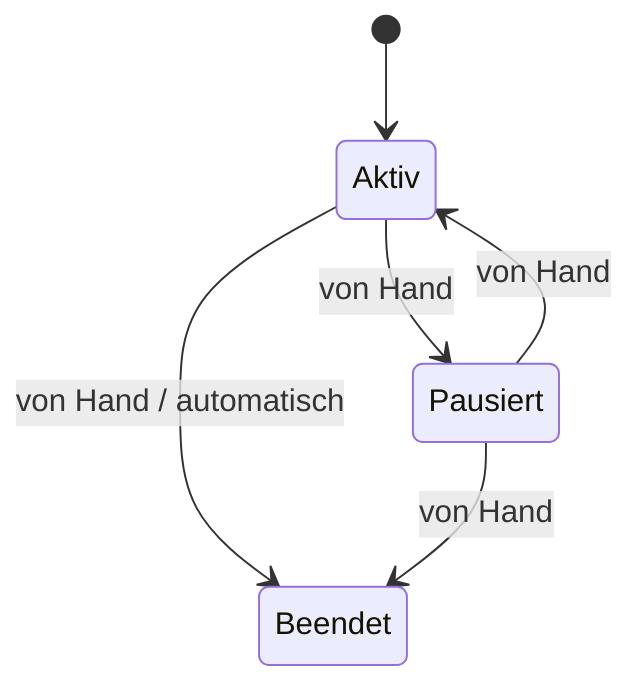

| Von | Nach | Auslöser | Wodurch | Bedingung |
|---|---|---|---|---|
| `active` | `paused` | von Hand | Pausieren | – |
| `paused` | `active` | von Hand | Fortsetzen | – |
| `active` | `ended` | von Hand | Beenden | – |
| `paused` | `ended` | von Hand | Beenden | – |
| `active` | `ended` | automatisch | Nächster Lauf läge hinter dem Enddatum | – |

- Rechnungen entstehen nur aus aktiven Vorlagen.
- Der Server prüft die Reihenfolge der Übergänge derzeit nicht; die Oberfläche bietet für beendete Vorlagen keine Aktion an.

### Lauf einer wiederkehrenden Rechnung (`recurringInvoiceRun`)

- Art: Protokollwert, ändert sich nicht
- Speicherort: `recurring_invoice_runs.status` · Typ `RecurringInvoiceRunStatus`

| Wert | Anzeige | Farbton | Endzustand |
|---|---|---|---|
| `success` | Erfolgreich | success | – |
| `failure` | Fehlgeschlagen | danger | – |

- Protokolleintrag je Lauf; der Wert ändert sich nach dem Anlegen nicht.

### Fixkosten (`recurringExpense`)

- Art: Ablauf mit Übergängen
- Speicherort: `recurring_expenses.status`
- Startzustand: Aktiv (`active`)

| Wert | Anzeige | Farbton | Endzustand |
|---|---|---|---|
| `active` | Aktiv | success | – |
| `paused` | Pausiert | warning | – |
| `ended` | Beendet | neutral | ja |

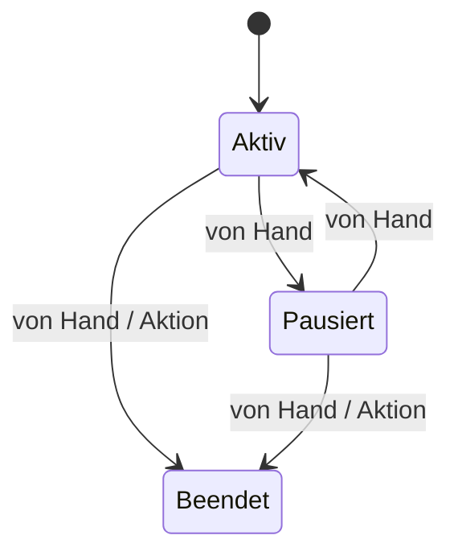

| Von | Nach | Auslöser | Wodurch | Bedingung |
|---|---|---|---|---|
| `active` | `paused` | von Hand | Pausieren | – |
| `paused` | `active` | von Hand | Fortsetzen | – |
| `active` | `ended` | von Hand | Beenden | – |
| `paused` | `ended` | von Hand | Beenden | – |
| `active` | `ended` | Aktion | Löschen mit Historie (wird archiviert) | – |
| `paused` | `ended` | Aktion | Löschen mit Historie (wird archiviert) | – |

- Der angezeigte Status wird zusätzlich aus Enddatum und Pausenzeiträumen abgeleitet (`currentExpenseStatus`).
- Ein unbekannter Statuswert wird beim Speichern abgelehnt; ohne Angabe gilt „aktiv“.

### Fälligkeit einer Fixkostenvorlage (`recurringExpenseRun`)

- Art: Ablauf mit Übergängen
- Speicherort: `recurring_expense_runs.status`
- Startzustand: Geplant (`planned`)

| Wert | Anzeige | Farbton | Endzustand |
|---|---|---|---|
| `planned` | Geplant | neutral | – |
| `confirmed` | Bezahlt | success | ja |
| `skipped` | Übersprungen | warning | ja |

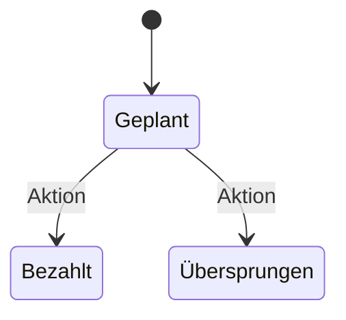

| Von | Nach | Auslöser | Wodurch | Bedingung |
|---|---|---|---|---|
| `planned` | `confirmed` | Aktion | Zahlung bestätigen | Fälligkeit nach aktueller Regel zulässig |
| `planned` | `skipped` | Aktion | Überspringen | – |

- Bestätigte und übersprungene Fälligkeiten sind endgültig; ein Datenbank-Trigger sperrt jede weitere Änderung.

### Importlauf (`importRun`)

- Art: Ablauf mit Übergängen
- Speicherort: `import_runs.status` · Typ `ImportRunStatus`
- Startzustand: Offen – rückgängig möglich (`pending`)

| Wert | Anzeige | Farbton | Endzustand |
|---|---|---|---|
| `pending` | Offen – rückgängig möglich | warning | – |
| `confirmed` | Abgeschlossen | success | ja |
| `reverted` | Rückgängig gemacht | neutral | ja |

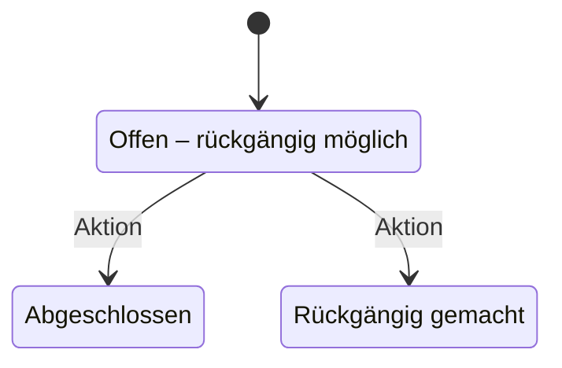

| Von | Nach | Auslöser | Wodurch | Bedingung |
|---|---|---|---|---|
| `pending` | `confirmed` | Aktion | Import abschließen oder Umzug beenden | – |
| `pending` | `reverted` | Aktion | Import rückgängig machen | – |

- Abgeschlossene und rückgängig gemachte Läufe sind endgültig.

### Umzug (Datenübernahme) (`migrationSession`)

- Art: Ablauf mit Übergängen
- Speicherort: `migration_sessions.status` · Typ `MigrationSessionStatus`
- Startzustand: Offen (`open`)

| Wert | Anzeige | Farbton | Endzustand |
|---|---|---|---|
| `open` | Offen | warning | – |
| `completed` | Abgeschlossen | success | ja |

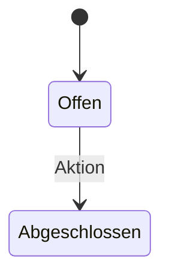

| Von | Nach | Auslöser | Wodurch | Bedingung |
|---|---|---|---|---|
| `open` | `completed` | Aktion | Umzug abschließen | – |

- Je Workspace gibt es genau einen Umzug; er lässt sich weder abbrechen noch wieder öffnen.

### Umzugskategorie (`migrationCategory`)

- Art: Ablauf mit Übergängen
- Speicherort: `migration_categories.status`
- Startzustand: Offen (`open`)

| Wert | Anzeige | Farbton | Endzustand |
|---|---|---|---|
| `open` | Offen | warning | – |
| `completed` | Erledigt | success | – |

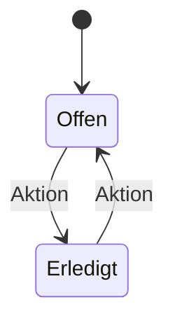

| Von | Nach | Auslöser | Wodurch | Bedingung |
|---|---|---|---|---|
| `open` | `completed` | Aktion | Kategorie importieren oder überspringen | – |
| `completed` | `open` | Aktion | Zugehörigen Import rückgängig machen | – |

### Belegerkennung (OCR) (`receiptOcr`)

- Art: Ablauf mit Übergängen
- Speicherort: `receipts.ocr_status` · Typ `ReceiptOcrStatus`

| Wert | Anzeige | Farbton | Endzustand |
|---|---|---|---|
| `pending` | Wartet auf Erkennung | neutral | ja |
| `processing` | Erkennung läuft | progress | ja |
| `completed` | Beleg erkannt | success | – |
| `failed` | Erkennung fehlgeschlagen | danger | – |

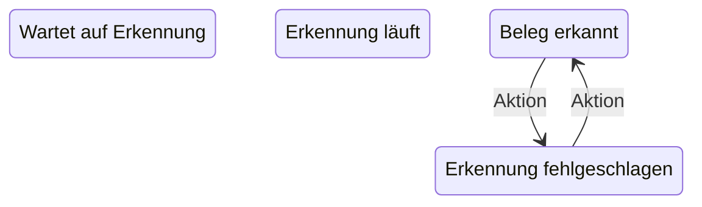

| Von | Nach | Auslöser | Wodurch | Bedingung |
|---|---|---|---|---|
| `failed` | `completed` | Aktion | Erkennung erneut starten | – |
| `completed` | `failed` | Aktion | Erneute Erkennung fehlgeschlagen | – |

- Die Erkennung läuft beim Hochladen synchron; ein Beleg entsteht direkt als „erkannt“ oder „fehlgeschlagen“.
- „pending“ und „processing“ sind in Datenbank und Typ vorgesehen, werden vom Server derzeit aber nicht geschrieben.
- Das Ergebnis ist immer ein Vorschlag; gebucht wird erst nach sichtbarer Bestätigung.

### EÜR-Buchung (`euerEntry`)

- Art: Ablauf mit Übergängen
- Speicherort: `euer_entries.status`
- Startzustand: Aktiv (`active`)

| Wert | Anzeige | Farbton | Endzustand |
|---|---|---|---|
| `active` | Aktiv | success | – |
| `voided` | Storniert | neutral | – |

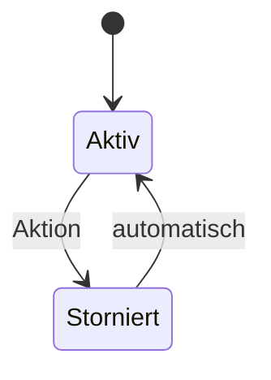

| Von | Nach | Auslöser | Wodurch | Bedingung |
|---|---|---|---|---|
| `active` | `voided` | Aktion | Stornieren | Begründung |
| `active` | `voided` | Aktion | Import rückgängig machen oder USt-Zahlung zurücksetzen | – |
| `voided` | `active` | automatisch | USt-Zahlung wieder als bezahlt erfasst | – |

- Buchungen werden nie gelöscht; jede Änderung steht in `euer_entry_history`.

### Anlage (`fixedAsset`)

- Art: Ablauf mit Übergängen
- Speicherort: `fixed_assets.status` · Typ `FixedAssetStatus`
- Startzustand: Aktiv (`active`)

| Wert | Anzeige | Farbton | Endzustand |
|---|---|---|---|
| `active` | Aktiv | success | – |
| `disposed` | Abgegangen | neutral | – |

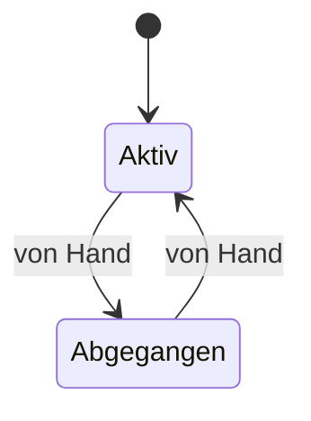

| Von | Nach | Auslöser | Wodurch | Bedingung |
|---|---|---|---|---|
| `active` | `disposed` | von Hand | Abgang erfassen | Abgangsdatum |
| `disposed` | `active` | von Hand | Abgang zurücknehmen | – |

### Eingangs-E-Rechnung (`incomingEInvoice`)

- Art: Protokollwert, ändert sich nicht
- Speicherort: `incoming_e_invoices.validation_status` · Typ `IncomingEInvoiceValidationStatus`

| Wert | Anzeige | Farbton | Endzustand |
|---|---|---|---|
| `validated` | E-Rechnung geprüft | success | – |
| `rejected` | Prüfung fehlgeschlagen | danger | – |

- Ergebnis der Prüfung beim Hochladen; der Wert ändert sich danach nicht.

### E-Mail-Protokoll (`emailLog`)

- Art: Protokollwert, ändert sich nicht
- Speicherort: `email_history.status`

| Wert | Anzeige | Farbton | Endzustand |
|---|---|---|---|
| `sent` | Gesendet | success | – |
| `failed` | Fehlgeschlagen | danger | – |

- Protokolleintrag je Versandversuch.

### Support-Ticket (`supportTicket`)

- Art: Bestand liegt außerhalb von SoloOffice
- Speicherort: keine eigene Statusspalte · Typ `SupportTicketStatus`
- Startzustand: In Bearbeitung (`open`)

| Wert | Anzeige | Farbton | Endzustand |
|---|---|---|---|
| `open` | In Bearbeitung | warning | – |
| `pending` | Antwort erhalten | primary | – |
| `resolved` | Gelöst | success | – |
| `closed` | Geschlossen | neutral | – |

- Der Bestand liegt im Control Plane; SoloOffice zeigt den Status nur an. Die Übergänge stehen in `control-plane/src/support.js`.

<!-- END GENERIERT -->

## Was an das Register angebunden ist

| Automat | Anzeige | Statusauswahl | Serverprüfung | Demo-Modus |
|---|---|---|---|---|
| Rechnung | Rechnungsliste, Dashboard, Mahnungen, Mahnversand, Reporting, Kundendetail, Verlauf | Sammeländerung in der Rechnungsliste | Werteliste; Übergangsregeln weiter in `invoicePolicy.js` und `invoiceService.js` | eigene Regeln in `demoApi.ts` |
| Gutschrift | Gutschriftenliste, Kundendetail | – | `validateCreditNoteStatus` | eigene Regeln |
| Angebot | Angebotsliste, Kundendetail | Sammeländerung in der Angebotsliste | `checkManualTransition` in `quoteService.js` | `checkManualTransition` |
| Auftrag | Auftragsliste, Dashboard, Kalender (Text), Kundendetail | – | Werteliste in `routes/jobs.js` | eigene Regeln |
| Wiederkehrende Rechnung und Läufe | Übersicht der Vorlagen | – | Werteliste | eigene Regeln |
| alle übrigen | noch eigene Beschriftungen in der jeweiligen Komponente | – | eigene Prüfungen | eigene Regeln |

## Abgeleitete Zustände ohne eigene Spalte

| Objekt | Zustand ergibt sich aus | Fundstelle |
|---|---|---|
| Zahlungsstand einer Rechnung (offen, teilbezahlt, bezahlt) | Summe der aktiven EÜR-Buchungen mit `source_type = invoice_payment` | `backend/queries/invoiceQueries.js`, `invoiceService.js` |
| USt-Periode (`not_due`, `open`, `partial`, `paid`, `overpaid`, `refund_open`, `settled`, `none`) | Fälligkeit und Zahlungen | `backend/shared/vat/index.js` |
| USt-Zahlung und private Abgabe (offen/bezahlt) | `paid_on` gesetzt oder leer | `backend/services/vatPayments.js`, `recurringExpenses.js` |
| Angezeigter Fixkostenstatus | Status, Enddatum und Pausenzeiträume | `src/utils/recurringExpenseDisplay.ts` |
| Einrichtung des Workspace | `currentStep`, `completedAt` | `SetupWizard.tsx`, `Layout.tsx` |
| Sitzung (lädt, abgemeldet, angemeldet) | `user`, `workspace`, Ladezustand | `src/context/AuthProvider.tsx`, `src/App.tsx` |

## Abläufe in der Oberfläche

| Ablauf | Zustände | Form heute | Fundstelle |
|---|---|---|---|
| Import-Assistent | `file`, `mapping`, `preview`, `courses`, `result` | Union-Typ `ImportStep`, Sprünge verteilt | `ImportWizard.tsx` |
| Einrichtungsassistent | Schritte 1 bis 5 | Zahl ohne Typ, „5“ an mehreren Stellen, zweite Quelle im Layout | `SetupWizard.tsx`, `Layout.tsx` |
| Datenübernahme | Schrittindex über offene/erledigte Kategorien | Zahl, per Effekt nachgeführt | `DataImportCenter.tsx` |
| Anmeldung | `login`, `register`, `forgot`, `reset` | Union-Typ `AuthMode` | `AuthPage.tsx` |
| Statuswechsel bei Aufträgen | `loading`, `success`, `error` | Union-Typ `StatusChangeFeedback` (Vorbild) | `JobManagement.tsx` |
| Speichern der Vorlagen | `idle`, `pending`, `saving`, `saved`, `error` | Union-Typ `SaveState` (Vorbild) | `TemplatesManagement.tsx` |
| Hintergrundaufgaben | `running`, `success`, `error` | Union-Typ `BackgroundTaskStatus` | `src/context/FeedbackContext.ts` |
| Seitenwechsel mit ungespeicherten Änderungen | frei, Rückfrage offen, bestätigt, abgebrochen | Refs und Rückschreiben der Adresse | `src/App.tsx`, `src/utils/navigationGuard.ts` |
| Laden, Speichern, Meldung je Seite | lädt, beschäftigt, Fehler, Hinweis | drei bis neun unabhängige `useState` in 19 Komponenten | u. a. `EmailManagement.tsx`, `ReceiptsManagement.tsx`, `BackupManagement.tsx` |
| Dialoge je Seite | genau ein Dialog offen | vier und mehr unabhängige Booleans in 8 Komponenten | u. a. `CustomerManagement.tsx`, `InvoiceManagement.tsx`, `JobManagement.tsx` |
| Seiten der Anwendung | rund 30 Seitennamen | freie Zeichenketten in fünf Dateien | `App.tsx`, `pageLoaders.ts`, `contentWidth.ts`, `Layout.tsx`, `hashRouter.ts` |

## Control Plane

Das Control Plane (`../control-plane`) führt eigene Zustände und ist nicht an
dieses Register angebunden. Es gibt dort Wertelisten, aber keine Tabelle
erlaubter Übergänge.

| Objekt | Werte | Absicherung |
|---|---|---|
| Konto | `active`, `blocked`, `deleted` | CHECK; `deleted` wird nirgends geschrieben |
| Abo | Stripe-Status sowie `incomplete` und `expired` | kein CHECK; Übergänge im Stripe-Webhook (`src/app.js`) und in `src/subscriptions.js` |
| Workspace-Bindung | `requested`, `provisioning`, `active`, `suspended`, `deletion_requested`, `deleted`, `error` | kein CHECK; `provisioning`, `deletion_requested` und `deleted` werden nicht geschrieben |
| Support-Ticket | `open`, `pending`, `resolved`, `closed` | CHECK und Werteliste in `src/support.js` |
| Zahlung, Zahlungsereignis, Checkout | `paid`/`failed`, `received`/`processed`/`failed`, `open`/`completed`/`expired` | kein CHECK |
| Einladung | gültig, widerrufen, abgelaufen, aufgebraucht | abgeleitet in `src/invites.js` |
| Aufbewahrungs- und Sicherungsläufe | `running`, `completed`, `failed` | kein CHECK |

## Offene Punkte

Diese Punkte ändern Verhalten oder brauchen eine Produktentscheidung. Sie sind
bewusst nicht Teil der Umstellung vom 09.11.2026.

1. **Auftrag von Hand „abgerechnet“:** Die Statusauswahl erlaubt das ohne
   Rechnung. Danach ist der Auftrag gesperrt und der Status nicht
   zurücknehmbar. Entweder die Option entfernen oder einen Rückweg anbieten.
2. **„Überfällig“ und „Abgelaufen“ entstehen im Browser:** Die Rechnungs- und
   die Angebotsliste setzen den Status beim Öffnen. Ohne Besuch der Liste
   bleiben Dashboard, Reporting und Erinnerungs-E-Mail beim alten Stand. Besser
   wäre eine Ableitung beim Lesen oder ein Serverlauf.
3. **Mahnstufen über das allgemeine Update:** Der Server nimmt
   `reminded_*` auch ohne Mahnlauf an und springt beliebig zwischen offenen
   Status. Mahndatum und höchste Mahnstufe bleiben dabei unverändert.
4. **Sammel-Download mit „als versendet markieren“:** Die Rechnungsliste
   schickt den Wechsel auch für bezahlte Rechnungen. Mit gebuchter Zahlung
   bleibt der Status erhalten; eine Altrechnung ohne Zahlungsbuchung fällt auf
   „versendet“ zurück.
5. **Angebote ohne Reihenfolge:** Zwischen Entwurf, versendet, akzeptiert,
   abgelehnt und abgelaufen ist jeder Wechsel erlaubt, auch zurück zum Entwurf.
6. **Wiederkehrende Rechnungen:** Der Server erlaubt, eine beendete Vorlage
   per Update wieder zu aktivieren; die Oberfläche bietet das nicht an.
7. **Anlagen:** „Aktiv“ lässt sich mit gesetztem Abgangsdatum speichern.
   Offen ist, ob die Rücknahme eines Abgangs das Datum leeren soll; dann
   muss Oberfläche und Demo-Modus mitziehen, bevor der Server „Aktiv“ mit
   Abgangsdatum ablehnt.
8. **Belegerkennung:** `pending` und `processing` werden nie geschrieben.
   Entweder nutzen (Erkennung im Hintergrund) oder entfernen.
9. **Demo-Modus:** Rechnungs- und Auftragsregeln stehen in `demoApi.ts`
    ein zweites Mal. Nächster Schritt wäre, die Rechnungsregeln als reine
    Funktion neben das Register zu legen und von beiden Seiten zu nutzen.
10. **Oberfläche:** Lade-/Fehler-Bündel und Dialog-Booleans als je ein
    Zustand mit Union-Typ führen; Seitennamen als ein Typ mit einer Liste.
11. **Control Plane:** Abo- und Workspace-Status ohne CHECK und ohne
    Übergangstabelle; der Relay zur Fachanwendung prüft nur den Kontostatus,
    nicht den Workspace-Status. Diese Punkte stammen aus einer Lesedurchsicht
    und sind vor einer Änderung am Code zu bestätigen.
